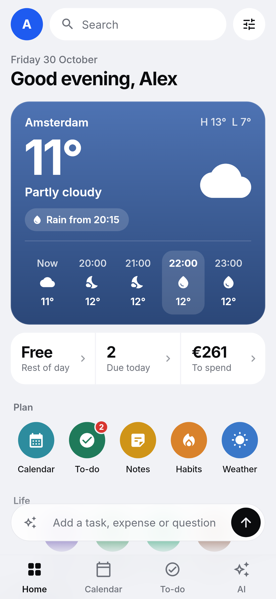
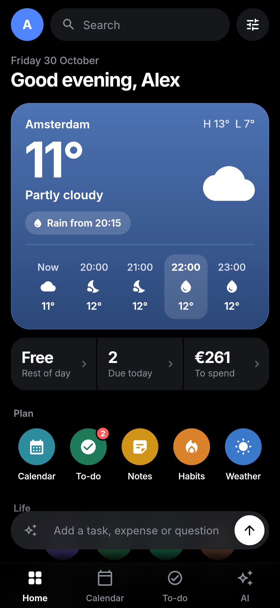

# Hub

**One app for the everyday stuff.** Hub is a personal "super app" for Android, Windows and iPhone, in the spirit of
WeChat's mini-apps: weather, calendar, tasks, notes, money, mail, news, shopping, work and study, plus a
shortcut into Claude, all behind one home screen you arrange yourself.

Everything lives on your own devices. There is no Hub account and no Hub server in the cloud. If you want
your phone and PC to share data, one of your own computers acts as the server (see
[Self-hosting](docs/SELF_HOSTING.md)).

<p>
  
  
  
  
</p>
<p>
  
  
  
  
</p>

## What's inside

| Mini-app | In short |
| --- | --- |
| **Home** | A dashboard of widgets. Hold any widget (or tap Edit) to arrange: resize (small, medium, large), change shape, style and colour, drag to move, or remove. Over 15 widget types, including app shortcuts. Tap your profile picture for settings. |
| **Weather** | Pick any place or use your location. Buienradar for rain in the next hours (NL/BE), Open-Meteo or Google Weather for the days ahead. |
| **Calendar** | Day, week, month and an endless agenda. Swipe between periods, several calendars, repeats, reminders, subscribed .ics calendars. |
| **To-do** | Quick add in plain words ("gym friday 7pm every week !"), reminders with Done and Snooze from the notification, repeating tasks, smart groups. |
| **Notes** | Coloured notes in a masonry grid, checklists you can tick from the preview, pinning, search. |
| **Wallet** | A monthly spending target with what is left and a daily allowance, net worth, round-ups into savings, "compared with your usual month" insights, spending by month, budgets, recurring payments and income, bank cards with live balances, savings goals, an investment portfolio with live prices, year overview and CSV import/export. |
| **Shopping** | Type everything in one line. Each item goes under the shop where it is usually cheapest, with an integrated AI price check against current offers. |
| **Job / University / your own** | A space each: important dates with countdowns, meetings, a plan with progress, saved notes, links and files. Job adds a work-day log with holidays left. Create your own spaces too. |
| **News** | Headlines from public RSS feeds across General, Netherlands, Greece, Politics, AI, Tech, Investing, Economy, Sports and Science. Add any feed. |
| **Mail** | Gmail, Outlook and Proton Mail (through Proton Mail Bridge) over IMAP/SMTP. |
| **Claude** | Opens the Claude app with a prompt ready. Uses your own Claude plan. |
| **AI** | Its own tab. Use your own Claude plan (through Claude Code or the Claude app, no API cost) or paste one API key: OpenRouter for any model, or Anthropic, OpenAI, DeepSeek or Llama (Groq or a local Ollama). A chat, a Hub agent that turns a sentence into expenses, notes, tasks or events after you confirm, and an AI price check for the shopping list. Keys stay in the device's secure storage. Personal agents and a DeepSeek-first setup are coming next. |

The full tour, screen by screen, is in **[docs/FEATURES.md](docs/FEATURES.md)**.

## Install

Every push to `main` builds the app on GitHub Actions. The newest builds are on the
[Latest build](../../releases/tag/latest) release.

- **Android:** download `Hub.apk` on the phone and open it. Allow "install unknown apps" for your browser the
  first time. New versions install over the old one and keep your data.
- **Windows:** download `Hub-windows.zip`, unzip it anywhere and run `hub.exe`.
- **iPhone:** no App Store or paid developer account needed. Download `Hub.ipa` on a computer and install it
  with [Sideloadly](https://sideloadly.io) or [AltStore](https://altstore.io), signing in with a free Apple ID.
  On the iPhone, trust your Apple ID under Settings > General > VPN & Device Management, and turn on
  Developer Mode when iOS asks. Apps signed with a free Apple ID run for 7 days; re-install (or let AltStore
  refresh it) to keep going. Your data stays.

## Build it yourself

You need Flutter 3.47 or newer.

```sh
flutter pub get
dart run build_runner build -d        # after changing lib/core/db/database.dart
flutter test                          # unit and widget tests
flutter run -d windows                # or -d <your phone>
flutter test screenshots --update-goldens   # re-render screenshots/out with demo data
```

More in **[docs/BUILDING.md](docs/BUILDING.md)**, including release signing.

## How it is put together

- **Flutter** for one codebase on Android, Windows and iOS.
- **SQLite through drift** for all data, with migrations tested against real older databases.
- **Sync** without a cloud: triggers stamp every row with a global id and edit time; devices exchange changes
  with a server you run, and the newest edit wins.
- **No accounts, no tracking, no API keys required.** Optional keys (Google Weather) stay on the device.

Details in **[docs/ARCHITECTURE.md](docs/ARCHITECTURE.md)**. What leaves your device, and when, is listed in
**[docs/PRIVACY.md](docs/PRIVACY.md)**.

## Documentation

| Document | For |
| --- | --- |
| [Features](docs/FEATURES.md) | Everything the app does, mini-app by mini-app |
| [Architecture](docs/ARCHITECTURE.md) | Code layout, data model, sync, notifications |
| [Building](docs/BUILDING.md) | Toolchain, tests, screenshots, CI and signing |
| [Self-hosting](docs/SELF_HOSTING.md) | Running a Windows laptop as your sync and mail server |
| [Privacy](docs/PRIVACY.md) | Which services Hub talks to and what it sends |
| [Changelog](CHANGELOG.md) | What changed, release by release |
