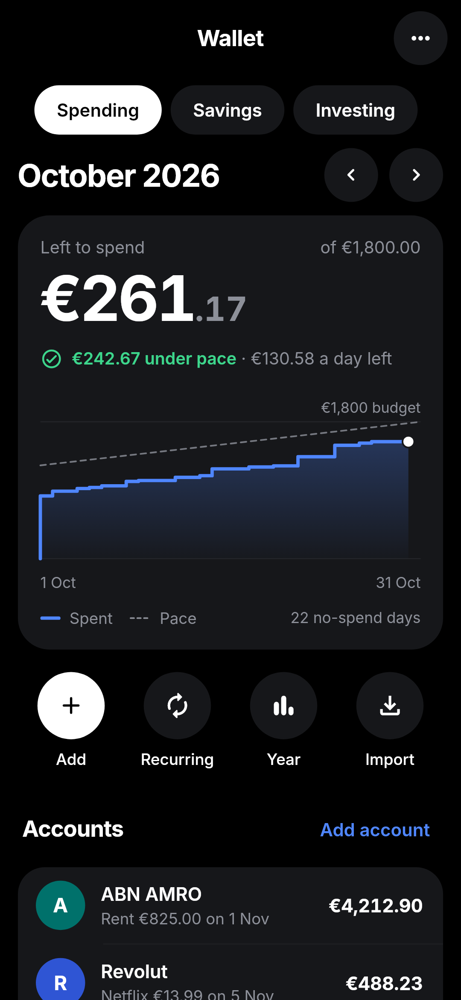
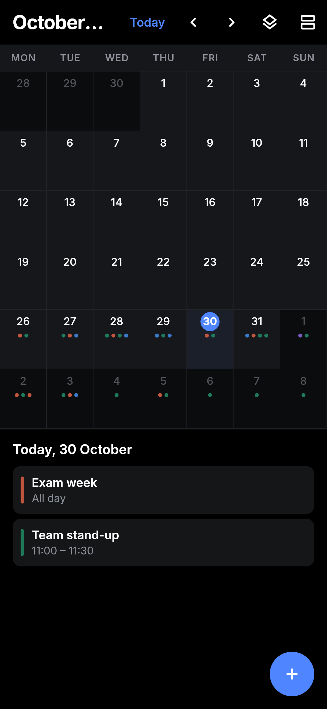
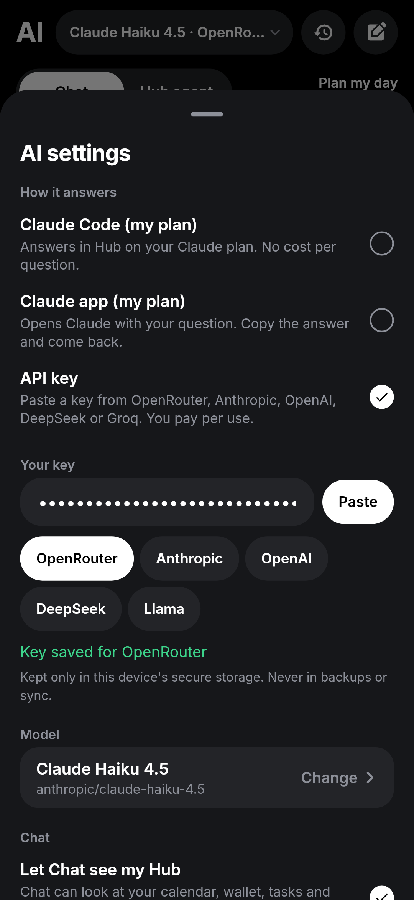
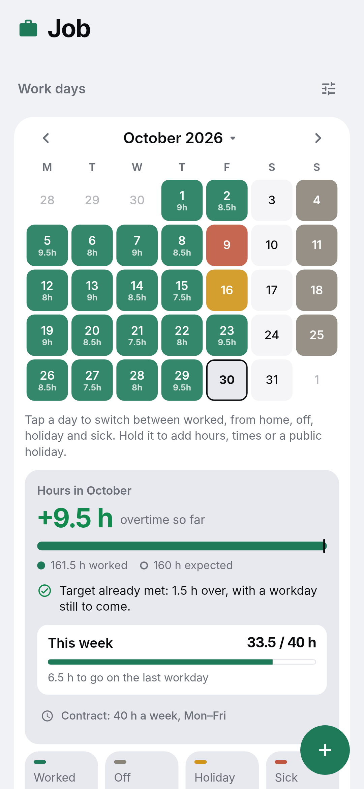
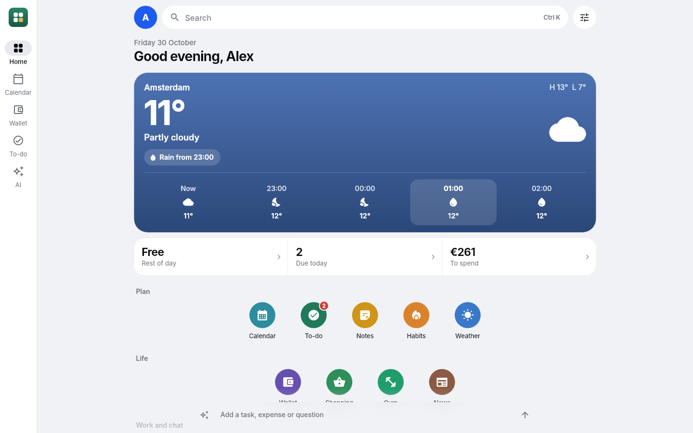

# Hub

**One app for the everyday stuff.** Hub is a personal "super app" for Android, Windows and iPhone, in the spirit of
WeChat's mini-apps: weather, calendar, tasks, notes, money, mail, news, shopping, work and study, plus a
shortcut into Claude, all behind one home screen you arrange yourself.

Everything lives on your own devices. There is no Hub account and no Hub server in the cloud. If you want
your phone and PC to share data, one of your own computers acts as the server (see
[Self-hosting](docs/SELF_HOSTING.md)).

<p align="center">
  
  
  
  
</p>
<p align="center">
  
  
  
  
</p>
<p align="center">
  
</p>

**Highlights**

- A home screen you arrange like a phone launcher: weather, your day, money and apps up top, widgets below.
- A Wallet that tells you if you are on track this month, with bills, subscriptions, savings goals and investments.
- An AI agent that can read your calendar, wallet, tasks, notes and spaces, and adds things only after you tap Add.
  Use your own Claude plan or any API key (OpenRouter for any model).
- Work and study spaces: a work log with hours and overtime, important dates, plans and saved files.
- No account and no cloud. Your data stays on your devices; sync goes through a computer you own.

## What's inside

| Mini-app | In short |
| --- | --- |
| **Home** | Weather, your day (free time, tasks due, money left) and your apps on top, then widgets you arrange: tap Edit or hold any widget to resize, reshape, recolour, move or remove it. Tap your profile picture for settings. Back from any tab returns here. |
| **Weather** | Pick any place or use your location. Buienradar for rain in the next hours (NL/BE), Open-Meteo or Google Weather for the days ahead. |
| **Calendar** | Day, week, month and an endless agenda. Swipe between periods, several calendars, repeats, reminders, subscribed .ics calendars. |
| **To-do** | Quick add in plain words ("gym friday 7pm every week !"), reminders with Done and Snooze from the notification, repeating tasks, smart groups. |
| **Notes** | Coloured notes in a masonry grid, checklists you can tick from the preview, pinning, search. |
| **Wallet** | Its own tab. What is left to spend this month and whether you are on track, a day-by-day strip with safe to spend today and where the month will end, recurring payments and income, bank cards with live balances, savings goals with on-track checks, an investment portfolio with live prices, year overview and CSV import/export. |
| **Shopping** | Type everything in one line. Each item goes under the shop where it is usually cheapest, with an integrated AI price check against current offers. |
| **Job / University / your own** | A space each: important dates with countdowns, meetings, a plan with progress, saved notes, links and files. Job adds a work log with hours worked or planned, contract hours, overtime or hours owed, and holidays left. Create your own spaces too. |
| **News** | Headlines from public RSS feeds across General, Netherlands, Greece, Politics, AI, Tech, Investing, Economy, Sports and Science. Add any feed. |
| **Mail** | Gmail, Outlook and Proton Mail (through Proton Mail Bridge) over IMAP/SMTP. |
| **Claude** | Opens the Claude app with a prompt ready. Uses your own Claude plan. |
| **AI** | Its own tab. Use your own Claude plan (through Claude Code or the Claude app) or paste one API key: OpenRouter for any model, or Anthropic, OpenAI, DeepSeek or Llama. A chat and a Hub agent that reads all your data (calendar, wallet, tasks, notes, spaces) and proposes changes you confirm with Add. Every conversation is kept in History, with token use and cost per chat and per month. Keys stay in the device's secure storage. |

The full tour, screen by screen, is in **[docs/FEATURES.md](docs/FEATURES.md)**.

## Install

Every push to `main` builds the app on GitHub Actions. The newest builds are on the
[Latest build](../../releases/tag/latest) release.

- **Android:** download `Hub.apk` on the phone and open it. Allow "install unknown apps" for your browser the
  first time. New versions install over the old one and keep your data.
- **Windows:** download `Hub-windows.zip`, unzip it anywhere and run `hub.exe`.
- **iPhone:** no App Store or paid developer account needed. Download `Hub.ipa` on a computer and install it
  with [Sideloadly](https://sideloadly.io) or [AltStore](https://altstore.io), signing in with a free Apple ID.
  On the iPhone, trust your Apple ID under Settings > General > VPN & Device Management, and turn on
  Developer Mode when iOS asks. Apps signed with a free Apple ID run for 7 days; re-install (or let AltStore
  refresh it) to keep going. Your data stays.

## Build it yourself

You need Flutter 3.47 or newer.

```sh
flutter pub get
dart run build_runner build -d        # after changing lib/core/db/database.dart
flutter test                          # unit and widget tests
flutter run -d windows                # or -d <your phone>
flutter test screenshots --update-goldens   # re-render screenshots/out with demo data
```

More in **[docs/BUILDING.md](docs/BUILDING.md)**, including release signing.

## How it is put together

- **Flutter** for one codebase on Android, Windows and iOS.
- **SQLite through drift** for all data, with migrations tested against real older databases.
- **Sync** without a cloud: triggers stamp every row with a global id and edit time; devices exchange changes
  with a server you run, and the newest edit wins.
- **No accounts, no tracking, no API keys required.** Optional keys (AI, Google Weather) stay in the device's secure storage.

Details in **[docs/ARCHITECTURE.md](docs/ARCHITECTURE.md)**. What leaves your device, and when, is listed in
**[docs/PRIVACY.md](docs/PRIVACY.md)**.

## Documentation

| Document | For |
| --- | --- |
| [Features](docs/FEATURES.md) | Everything the app does, mini-app by mini-app |
| [Architecture](docs/ARCHITECTURE.md) | Code layout, data model, sync, notifications |
| [Building](docs/BUILDING.md) | Toolchain, tests, screenshots, CI and signing |
| [Self-hosting](docs/SELF_HOSTING.md) | Running a Windows laptop as your sync and mail server |
| [Privacy](docs/PRIVACY.md) | Which services Hub talks to and what it sends |
| [Changelog](CHANGELOG.md) | What changed, release by release |
