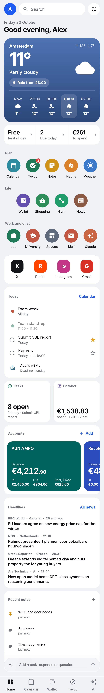
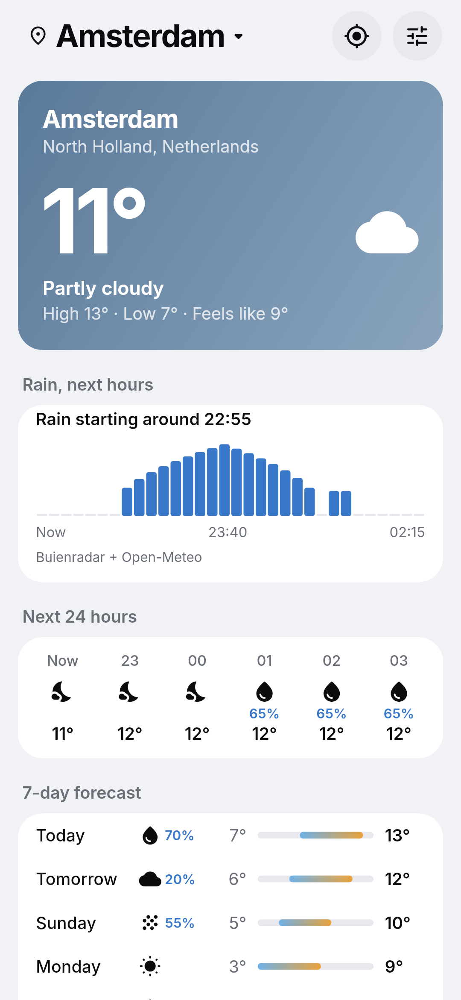
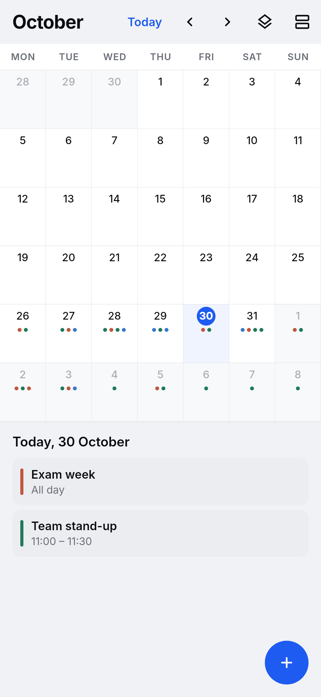
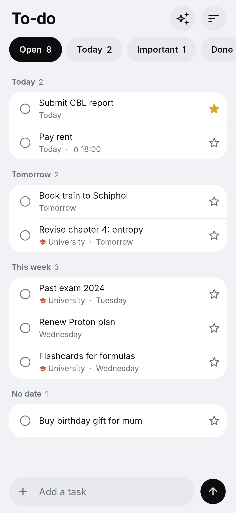
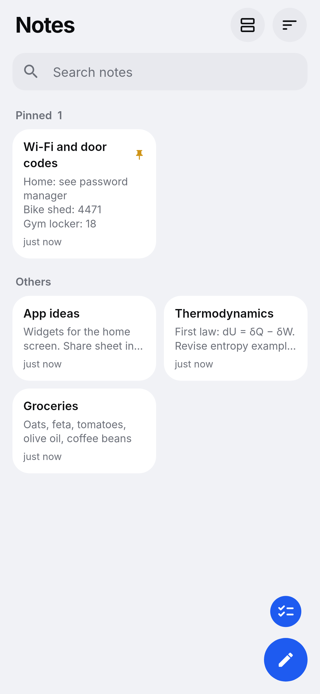
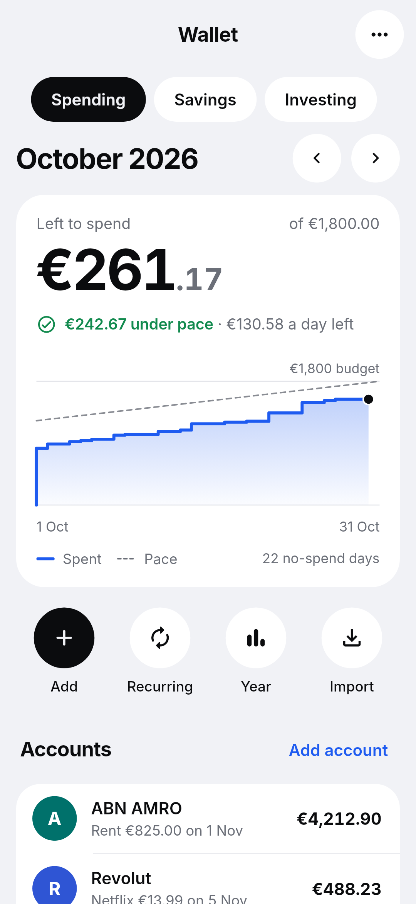
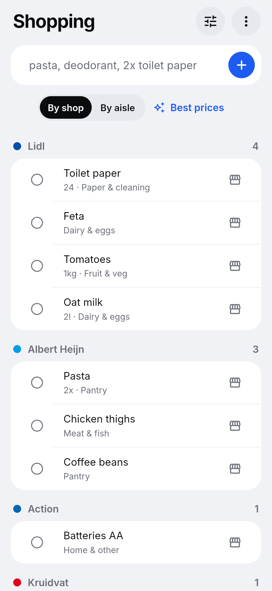
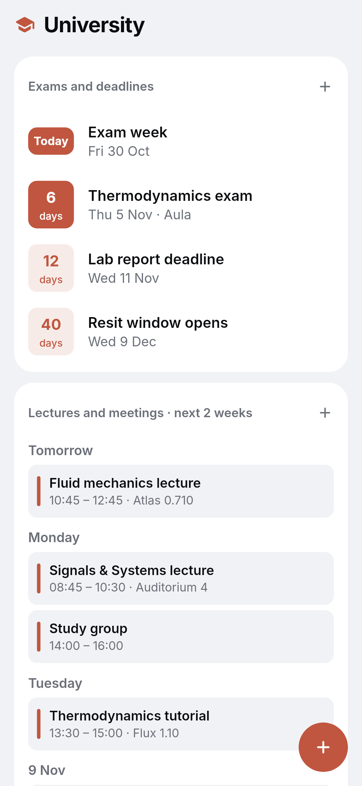
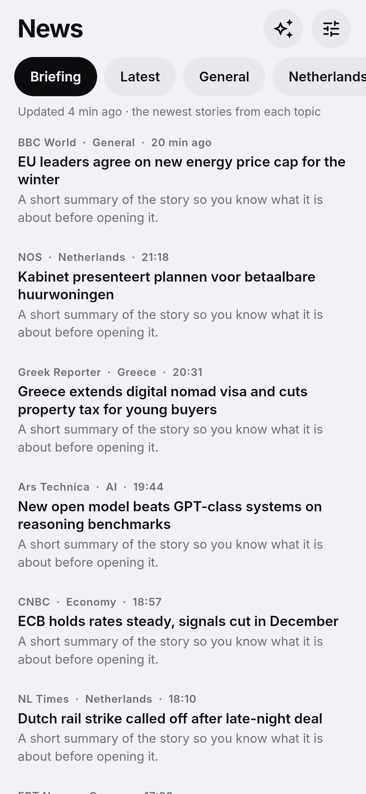

# Features

A tour of Hub, mini-app by mini-app. Screenshots are rendered from demo data by
`flutter test screenshots --update-goldens`, so they always match the code.

## Home: a dashboard you arrange

The home screen is a grid of widgets. Two ways to change it:

- **Hold any widget** to open its settings, or
- tap the **Edit home** button next to your avatar.

For each widget you can choose:

| Setting | Options |
| --- | --- |
| Size | Small (half a phone row, a third on wide screens), Medium (full row on phones, half on wide screens), Large (full row) |
| Shape | Square, Soft, Rounded, Round corners |
| Style | Card, Tinted, Outline, No card |
| Colour | Eight accent colours for icons, tints and outlines |
| Position | To the top, up, down, or hold and drag in edit mode |

**Add a widget** at the bottom of edit mode opens the gallery:

| Widget | Shows |
| --- | --- |
| Search | Search across notes, tasks, events and mail |
| Weather | Now, today's high and low, rain in the next hours (compact when small) |
| Apps | Every Hub mini-app |
| Shortcuts | Your chosen apps: X, Instagram, Reddit, TikTok, GitHub, LinkedIn, Outlook, Gmail, Proton Mail, WhatsApp, banks (ING, Rabobank, bunq, Revolut, ABN AMRO, Eurobank…), brokers, DigiD and more, or any link you add. Opens the installed app when there is one, otherwise the website |
| Quick add | New task, note, expense or event in one tap |
| Today | Events, tasks, application deadlines and payments due today |
| Clock | Time, date and week number |
| Next event | What is coming up |
| Tasks | Open tasks, most urgent first |
| This month | Spent, earned and net |
| Bank cards | Each card's balance, or the total when small |
| Shopping | How much to buy and at which shops |
| Savings | Saved towards goals |
| Investing | Portfolio value and gain |
| Work days | Days worked this month and holidays left |
| Headlines | Latest news |
| Notes | Latest notes |

The layout is saved on the device. **Back to the starting layout** (in edit mode) resets it.

 

## Weather

- Tap the place name to switch places, search any city, or **use my location**.
- **Next hours:** Buienradar's rain forecast, five-minute steps for the next two hours (Netherlands and Belgium).
- **Days ahead:** Open-Meteo by default, or Google Weather if you add your own key in Weather → Sources.
- Hourly forecast for 24 hours, ten days, sunrise and sunset, wind, UV, humidity.

 

## Calendar

- Day, week, month and agenda views. Swipe sideways to move through time; the agenda keeps loading as you scroll.
- Several calendars with colours, show or hide each. Personal, Work and Study come ready.
- Repeating events (daily, weekly, monthly, yearly, custom), all-day events, reminders.
- Subscribe to any `.ics` link (university timetable, sports fixtures, holidays). Hub refreshes it.

 

## To-do

- **Quick add in plain words:** `Call mum tomorrow 6pm`, `Gym every monday 7:30`, `Pay rent 1 nov !` (the `!` marks it important). A preview shows what Hub understood.
- Filters: Open, Today, Important, Done. Groups: Overdue, Today, Tomorrow, This week, Later, No date.
- Reminders as notifications with **Done** and **Snooze 10 min** buttons, exact to the minute where the phone allows.
- Repeating tasks: tick one off and the next appears.
- Tasks can belong to a space (Job, University or one of your own).
- Swipe right to complete, left to delete (with undo).

 

## Notes

- Masonry grid with pinned notes on top and eight note colours.
- Checklists: tick items straight from the grid. Lists continue when you press Enter.
- Toolbar for checklist, bullets and a timestamp; word count; copy; untick all.
- Full-text search.

 

## Wallet

**Spending**

- **Am I on track?** The top card shows what is left to spend this month and whether you are under or over pace.
  Below Accounts, **Day by day** has a bar for each day, green dots for no-spend days, **safe to spend today**,
  where the month will end at this rate, and the bills still to come. Recurring bills are counted as fixed costs
  first, so the pace only measures everyday spending.
- Month view with a month picker, a "Now" button and swipe to change month.
- In, out and net; a six-month trend; spending by category against budgets.
- **Bank cards:** one card per account (ABN AMRO, Revolut and Eurobank come ready; add more). Set the balance once and Hub keeps it current from the entries booked to that account. Each card shows money in and out this month and the next payment. Open a card to choose which recurring payments go through it and see its activity.
- **Recurring:** subscriptions, rent, insurance, salary and allowances. Hub books each one on its date and shows fixed costs and recurring income per month.
- **Import** bank exports: Revolut CSV, ABN AMRO TXT, Eurobank CSV. **Export** everything to CSV.
- **Year overview** with totals per category and taxes.

**Savings:** goals with targets and deadlines, deposits and withdrawals, how much a month you need, and whether you
are on track, ahead or behind plan.

**Investing:** holdings (ETFs, stocks, crypto, funds) with live prices from Yahoo Finance, converted to your currency; value, gain and allocation.

 

## Shopping

- Type everything in one line: `pasta, deodorant, 2x toilet paper, milk 2l`.
- Each item is sorted into a kind (pantry, personal care, paper and cleaning…) and placed under the shop where that kind is usually cheapest. The defaults are Dutch shops (Albert Heijn, Lidl, Aldi, Kruidvat, Action…) and you can change them under **Cheapest shops**.
- Move an item to another shop once and Hub remembers it for next time.
- **Best prices** asks Claude (in the Claude app, on your plan) which shop is cheapest for each item right now. Copy the reply and choose **Use Claude's answer**: Hub reads it and moves the items.
- View by shop or by aisle, tick items into the basket, clear the basket.

 

## Job, University and your own spaces

Each space has its own calendar and these sections:

- **Important dates** with a countdown (exams, deadlines, conferences).
- **Meetings** for the next two weeks.
- **Plan:** tasks with a progress bar and inline add (a study plan, a research plan).
- **Saved:** notes, links and files that belong to the space.

**Job** also has a **work log**: tap a day to mark it worked, worked from home, off, holiday or sick; hold it to enter
hours worked (or planned, on future days), start and end times with a break, or a public holiday. Set your contract
under the tune button, as hours a week or hours per weekday. Hub shows hours worked and planned against expected
for the month and the week, your overtime balance or the hours still owed, what you need per remaining workday, and
a balance for the year next to holidays left.

 

## News

- Topics: Briefing, Latest, General, Netherlands, Greece, Politics, AI, Tech, Investing, Economy, Sports, Science.
- Feeds from BBC, The Guardian, NOS, NL Times, Politico Europe, The Verge, Ars Technica, MIT Technology Review, CNBC, MarketWatch and more. Turn any off or add your own RSS or Atom feed.
- **Summarise with Claude** turns today's headlines into a short briefing in the Claude app.
- Works offline with the last loaded headlines.

 

## Mail

- Gmail and Outlook through IMAP/SMTP (Outlook signs in with a Microsoft device code), Proton Mail through Proton Mail Bridge running on your own computer.
- Passwords are kept in the operating system's secure storage and never sync.

## AI

- The AI tab is the chat: switch between **Chat** (a general assistant) and the **Hub agent** (adds expenses,
  notes, to-dos, events and shopping after you tap Add on each change). Starter suggestions, Stop while it thinks,
  copy under each answer, New chat. The model chip at the top opens **AI settings**.
- **How it answers**: **Claude Code (my plan)**, **Claude app (my plan)** or **API key**.
- **API key**: paste any key and Hub works out whose it is from how it starts (`sk-or-` OpenRouter, `sk-ant-`
  Anthropic, `sk-proj-` OpenAI, `gsk_` Groq; a plain `sk-` is tried on OpenAI, then DeepSeek), checks it and shows
  Connected or a plain error. Keys live only in the device's secure storage, never in settings, backups or sync.
- **OpenRouter: one key, any model.** Pick from OpenRouter's live model list with context size and price per million
  tokens, searchable, with a few suggestions (Claude Haiku, a small GPT, DeepSeek, Llama, Claude Sonnet) on top.
  Chat, the Hub agent and the shopping price check all work through it.
- Rate limits and server errors are retried once or twice, then shown in plain words (wrong key, no credit, model not
  available, no connection, too slow).
- **Claude Code (my plan)** answers with your own Claude plan through Claude Code (`claude -p`) on your computer, or on
  the laptop running Hub in Server mode when you are on your phone, with Haiku, Sonnet or Opus. You sign in by running
  `claude` once yourself; Hub never handles the login. Setup is in `server/README.md`.
- **The Hub agent reads all your data** through tools: calendar for any dates, recurring payments and subscriptions,
  transactions, balances, savings, investments, notes, tasks, habits, shopping, spaces, the work log and weather.
  Each answer says what it looked at. Models without tool support get a full snapshot in the prompt instead.
- **History**: every conversation is kept per mode. Reopen, search, rename or delete them; the empty chat lists the
  latest three.
- **Usage**: tokens per message and per conversation, totals for today, this month and all time per model, and cost
  for OpenRouter models (from OpenRouter's reported cost or its price list). Open it from AI settings.

## Claude

- Opens a new chat in the Claude app (or claude.ai) with your prompt filled in and copied.
- Used by News, Shopping and anywhere a "Claude" button appears. Hub does not use the paid Claude API.

## Me

Name, theme (light, dark, system), temperature unit, currency, notifications, sync settings, and the places
for optional keys.
